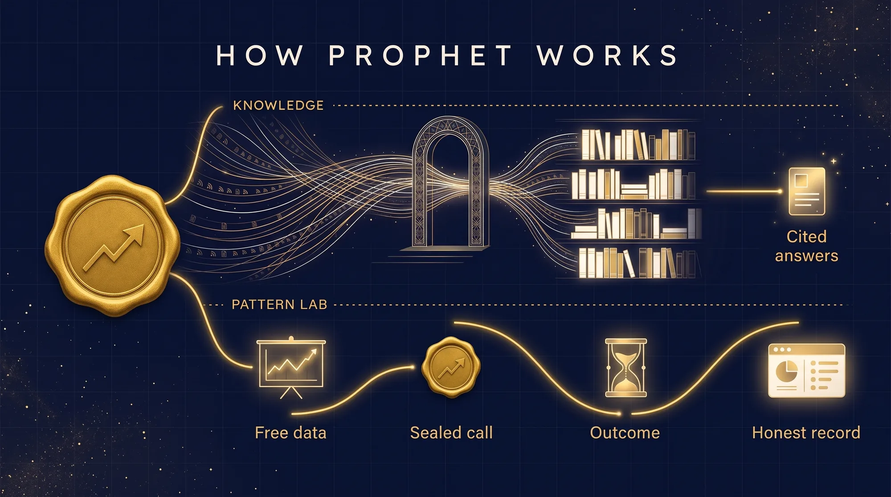

<p align="center">
  
</p>

# Prophet

**Prophet is a receipt book for predictions.**

## Make the call. Lock it in. Get graded.

Prophet writes your predictions down before they happen, then scores them against the obvious guess.
Free, on your own computer, no account.

| 1. Call it | 2. Lock it | 3. Grade it |
|---|---|---|
| Write a question, a date and how sure you are. | Prophet seals the call. Any later edit shows. | Prophet scores you next to the lazy guess. Wins and misses stay together. |

*Practice runs: Prophet also replays old data as a rehearsal. A rehearsal is not a track record. Its results, good and bad,
are listed under [Practice runs](#practice-runs).*

## How it works

<p align="center">
  
</p>

More pictures: [the life of a sealed call](assets/diagram-journey.webp) and [polite by design](assets/diagram-gate.webp).

Prophet has three commands (`ask`, `ub` and `lab`) and one script, the source harvester.

<table>
  <tr>
    <td align="center" width="25%"><br><b>Ask</b><br>Search what you collected</td>
    <td align="center" width="25%"><br><b>UB</b><br>Exact Urantia Book lookup</td>
    <td align="center" width="25%"><br><b>Lab</b><br>Make the call, lock it in, get graded</td>
    <td align="center" width="25%"><br><b>Harvest</b><br>Download public sources, politely</td>
  </tr>
</table>

---

> **Name note.** Meta also publishes an open-source forecasting library called Prophet (`facebook/prophet`).
> This project is a different thing and shares nothing with it but the word.

| Command | What it does |
|---|---|
| `prophet ask` | Search the transcripts, notes and findings you collected; each answer shows a link and a snippet |
| `prophet ub` | Exact Urantia Book passages with citations, read by the UB tools on your computer, plus your own notebooks |
| `prophet lab` | Make the call, lock it in, get graded: sealed predictions on anything, scored against the obvious guess |
| `python source_harvest.py` | Downloads the public sources in `sources/sources.json` into notebooks that `ask` can search (it uses the network; `--list` does not) |

Run `prophet` with no arguments to print the list of commands. In this README, `prophet` means `python prophet.py` run from
this folder, or the launcher once the folder is on your PATH (see Install).

**Studio-specific skills are not included.** Prophet also has skills that only make sense inside the author's own film studio
setup (they work on its cut documents, renders and private notes). They are left out of this repository on purpose, and the
`prophet` command lists only the skills that are here.

`approve_sources.py` is the one-time approval step of the harvester: the harvester will not run until you have read the source
list and said yes. `prophet_net.py` is a library, not a script: it holds the download rule that the harvester and the Pattern
Lab share (see "How the record stays honest", item 7).

## See it work in one minute

A call that resolves today, graded in the same minute. Run these from the folder you cloned. They touch only your data
folder and never the network.

```
python prophet.py lab call --domain demo --question "Will my die roll show a 5 or a 6?" --resolves today --prob 0.33
python prophet.py lab resolve <id> --outcome no
python prophet.py lab verify
python prophet.py lab record
```

The first command prints the id of the call (`demo:manual:2026-10-25:76d4e642` below). Real output looks like this:

```
Sealed demo:manual:2026-10-25:76d4e642
  question: Will my die roll show a 5 or a 6?
  call 0.33  baseline 0.5 (coin flip)  resolves 2026-10-25T23:59:59Z  seal 9c04c15a7af33fc1c51ef12435d2d7d980bcd4d307deb836af435335a573eefe
```

1. **Call it and lock it.** You said 33% that the die shows a 5 or a 6. Prophet sealed the call and wrote down the lazy guess
   next to it. With no `--baseline`, the lazy guess is a coin flip (50%). `today` and `tomorrow` work for `--resolves`; all
   dates are UTC.
2. **Roll the die, then grade it.** Use `--outcome yes` or `--outcome no`:

   ```
   Scored demo:manual:2026-10-25:76d4e642 (resolved before its date): outcome 0; score 0.1089 vs baseline 0.2500; the call was better than the baseline
   ```

   Prophet says "resolved before its date" because you graded the call before the end of its day. A real call should wait for
   its date. The record page marks early grades too.
3. **Check it and look at it.** `lab verify` re-checks every seal. `lab record` writes `record.html`: open it from
   `<data folder>/notebooks/pattern-lab/`.

One call proves nothing. Prophet claims a result for a kind of question only after 30 graded calls.

## Install

You need:

* Python 3.11 or newer (`python --version`)
* the Python packages in requirements.txt (numpy): `pip install -r requirements.txt`

Optional, only for the parts that use them:

* Node.js 18 or newer and the [UB tools](https://github.com/UBN606/ub-tools), only for `prophet ub` (the set-up steps are under "Prophet remembers"). The book text is not part of this repo.

```
git clone <this repository>
cd prophet
pip install -r requirements.txt
python prophet.py
```

`prophet.cmd` (Windows) and `prophet` (macOS and Linux; run `chmod +x prophet` once) are thin launchers for
`python -B prophet.py`. Put the folder on your PATH and you can type `prophet` anywhere.

Prophet was built and tested on Windows. The code is portable Python and the shell launcher covers macOS and Linux, but those
two have not been exercised yet.

## Where Prophet keeps things

One data folder holds everything Prophet writes. By default it is `~/prophet-data` (on Windows `%USERPROFILE%\prophet-data`).
Move it with the environment variable `PROPHET_HOME`, or copy `prophet.example.toml` to `prophet.toml` and edit it. The same
file (or `PROPHET_<KEY>` variables) points the optional parts at your own folders. To see what Prophet resolved:

```
python prophet_config.py
```

Nothing Prophet writes ever goes into this repository folder.

## The record page

`prophet lab record` writes two files into the lab folder, `<data folder>/notebooks/pattern-lab/`:

* `record.html`: one self-contained page (no scripts, no web fonts, nothing loaded from the internet). It shows how many
  calls are sealed, graded and waiting, the chain head and its anchor status, a scoreboard for each kind of question with
  Prophet next to the lazy guess (live calls first, practice runs apart), the biggest misses next to the biggest wins, every
  call as a card, and the words used on the page. It works on a phone and follows your light or dark setting.
* `RECORD.md`: the same facts as plain text, which `prophet ask` can search.

Both are built from the sealed files only (`calls.jsonl`, `scores.jsonl`, the practice summaries and `anchors.jsonl`).
Nothing on them is typed by hand. If a seal does not match, the page says TAMPERED at the top.

## Prove when you made a call

A seal shows that a call was not edited. It does not show when you made it, because the date comes from your computer's
clock. Anyone could seal a call tomorrow and say it was made today.

`prophet lab anchor` closes that gap. It sends your chain head to two public OpenTimestamps servers and saves their receipt:

```
prophet lab anchor --dry-run     # shows what would be sent and where; sends nothing, writes nothing
prophet lab anchor               # sends it and saves the receipt
```

* **What leaves your computer:** one 32-byte hash, the chain head. No question, no number, no file name. The two servers
  (`a.pool.opentimestamps.org` and `b.pool.opentimestamps.org`) see your IP address and the time, as any web server does.
* **What stays:** the lab folder gets `anchors/<date>_<head>.ots-pending` and one line in `anchors.jsonl`. The receipt holds
  both servers' answers exactly as they came; the log line records each answer's size and SHA-256. Prophet will not anchor a
  record that fails `lab verify`, and it will not send the same chain head twice unless you pass `--again`.
* **What the receipt means:** it is **pending**. The servers have the hash and will commit it to Bitcoin, usually within
  hours. A pending receipt is not proof yet, and Prophet never calls it confirmed.

To finish the proof later, use the official [OpenTimestamps client](https://github.com/opentimestamps/opentimestamps-client):

```
pip install opentimestamps-client
cp anchors/2026-10-25_9c04c15a7af3.ots-pending proof.ots    # a name that ends in .ots
ots upgrade proof.ots                                       # fetches the Bitcoin proof once it exists
ots info proof.ots                                          # shows what the receipt says
ots verify -d <chain head> proof.ots                        # checks it; the client's own documentation says what it needs
cp proof.ots anchors/2026-10-25_9c04c15a7af3.ots-pending    # optional: keep the upgraded receipt in the lab folder
```

Once the upgraded receipt is back in the lab folder, it holds a Bitcoin block. The record page then says the file *claims* that
block and tells you to check it with `ots`. Only `ots verify` can confirm it. Run `anchor` again after you seal new calls: the
new chain head covers all the earlier ones.

## Prophet remembers

Calls are better when you check what you already know. Prophet's other job is to remember it: search what you collected,
then record where a call came from with `lab call --source <url>`.

### Search what you collected: `prophet ask`

```
prophet ask picnic
prophet ask -c my-notes radar        # only one channel (part of the name is enough)
prophet ask --json "home advantage"  # machine readable
prophet ask --stats                  # what is searchable right now
```

`ask` reads files on your computer and never uses the network. Each result is three lines:

```
1. my-notes | Call with Sam @ 0:41
   https://example.com/where-this-came-from
   ...ain will hold off until the weekend. We agreed to check the radar again on Friday before deciding about the picnic.
```

The first line is the number, the channel and the title. `@ m:ss` appears only when the passage has a time code. The second
line is the link: the `url` from the file's front matter (a YouTube link opens at that second), or empty when the file has
none. The third line is a snippet. With `--json`, each result also carries the date, the kind, the score and the path of the
file.

**The notes `ask` reads.** Markdown files in your notebooks folder (`<data folder>/notebooks/<folder>/<name>.md`) and in
`<data folder>/local/<folder>/<name>.md`. A note may start with front matter, between two `---` lines:

```
---
title: "Call with Sam"
channel: "my-notes"
url: "https://example.com/where-this-came-from"
upload_date: "2026-10-20"
---
[0:05] Sam thinks the rain will hold off until the weekend.
[0:41] We agreed to check the radar again on Friday before deciding about the picnic.
```

Every field is optional. Without `title`, the file name is used. Without `channel`, `ask` uses the name of the folder above the
file's own folder, so set `channel` if you want to filter with `-c`. A value in double quotes is read as JSON. A line that
starts with `[m:ss] ` (minutes, a colon, two digits of seconds, a space) is a time mark: `ask` groups about a minute of marked
lines into one passage and reports the time of the line that matches best. Text without marks is split into passages at blank
lines. Files named `INDEX.md` are skipped, and `ask` rebuilds its search index by itself when the files change.

### Exact Urantia Book passages: `prophet ub`

```
prophet ub prayer                    # top passages for a word or phrase
prophet ub --ref 180:2.1 180:2.2     # the exact paragraph text for a citation
prophet ub prayer --with-notebooks   # the same words also asked of your notebooks
```

`prophet ub` runs the Node.js tools of the [UB tools](https://github.com/UBN606/ub-tools) on your computer. It looks for two
files in the UB tools folder, `ub-search.js` and `ub-verify.js`, and runs `ub-search.js`. Prophet itself opens no network
connection for this. The book text is not part of this repo: every passage comes from the UB tools, never from memory.

Set the UB tools up once. You need Node.js 18 or newer:

```
git clone https://github.com/UBN606/ub-tools <data folder>/ub-tools
cd <data folder>/ub-tools
node fetch-data.js
```

`fetch-data.js` downloads the book text (about 14 MB) from Urantiapedia once, under CC BY-SA 4.0, and builds a search index.
That download is the only network use; after it the tools work offline. If you keep the UB tools in another folder, set
`ub_tools` under `[paths]` in `prophet.toml`.

### Collect public sources: `source_harvest.py`

```
python approve_sources.py                                 # read the list, then say yes (writes an approval file)
python source_harvest.py --list                           # what would be fetched; fetches nothing
python source_harvest.py --area weather_climate --limit 5 # one area, a few items per source
python source_harvest.py --source gh_comfyui --dry-run    # downloads and parses one source, writes nothing
```

The harvester downloads public sources (feeds, data files, official APIs) and turns them into Markdown that `ask` can search.
Output lands in `<data folder>/notebooks/sources-<area>/`. `--list` fetches nothing; `--dry-run` does download, but writes
nothing. `--list` also marks the sources that are read through an official API on the robots allowlist, and the ones that are
disabled. Start small with `--limit`; the hard cap is 50 items per source per run.

## Words used here

* **Call**: a prediction written down before the answer is known. A chance for a yes or no question (like 70%), or a number.
* **Seal**: a fingerprint (SHA-256) of the call, chained to the seal before it. Any edit changes it, and `lab verify` says
  TAMPERED.
* **Chain head**: the seal of your newest call. One line that stands for the whole list.
* **Anchor**: a dated receipt for the chain head from OpenTimestamps. A seal shows nothing was edited. Only an anchor shows when.
* **Lazy guess** (the baseline): what a plain rule says with no thinking, such as "same as today", "the usual rate for this
  date" or a coin flip. Prophet is graded next to it. It is a simple reference point, not a strong test: being ahead of it is
  a starting point, not proof of skill.
* **Grade** (the commands say `score` and `resolve`): compare a call with what happened.
* **Brier score**: for a yes or no call, how far your chance was from what happened (1 if it happened, 0 if not), squared.
  0 is perfect. Always saying 50% scores 0.25. Lower is better.
* **Average miss**: for a number call, such as tomorrow's high temperature, how far off the call was, in degrees, averaged over
  many calls. Lower is better.
* **Win and miss**: a graded call is a win when Prophet's score beat the lazy guess on that call, and a miss when it did not.
* **Practice run** (the commands say `backtest`): a replay of history, one day at a time, using only what was known before that
  day. A rehearsal, not a track record.

## Pattern Lab in detail

```
prophet lab call --domain politics --question "Will X happen by 2027-06-30?" --resolves 2027-06-30 --prob 0.62
prophet lab resolve <id> --outcome yes
prophet lab list                     # every call and its grade
prophet lab verify                   # check every seal and the hash chain
prophet lab record                   # write RECORD.md and record.html
prophet lab anchor --dry-run         # show what `anchor` would send; sends nothing
prophet lab domains                  # what each built-in domain is, and where its free data comes from
prophet lab backtest weather         # practice run: replay history walk-forward (downloads public data)
prophet lab predict weather          # lock in live calls for things that have not happened yet (downloads public data)
prophet lab score                    # grade locked calls whose result is now in the data (downloads public data)
```

Any question can be called by hand with `call` and graded with `resolve`. The built-in domains make their own calls from free
public data: `weather` (tomorrow's high temperature and whether it rains, from Open-Meteo), `sports` (football home win,
football-data.co.uk results), `markets` (index closes, the public FRED CSV), `geopolitics` (the daily share of protest,
violence and sanctions events among the events GDELT codes, counted from its daily event files), `business` (SEC EDGAR; off
until its owner chooses the contact line EDGAR requires) and `racing` (no free data source was found, so it only takes
hand-made calls). Every download the lab makes passes the same robots.txt rule as the harvester (see item 7 of "How the record
stays honest"). The `geopolitics` domain downloads one GDELT 1.0 daily event file (about 7 MB) per day, at least 2 seconds
apart, counts the events by type while unzipping it, keeps only the counts and the file's hash in `gdelt_daily_counts.csv` and
deletes the file; a day already counted is never downloaded again. The window is the last 120 days (`--days N` changes it).
GDELT's DOC API stays as a fallback that is off unless you pass `--gdelt-doc-api`: it keeps GDELT's rate limit (at least 6.5
seconds between requests, and on HTTP 429 one retry after 10 seconds, after which the domain stops with an error and seals
nothing).
A new domain is one file named `prophet_lab_<name>.py` next to `prophet_lab.py`; the "How to add a domain" section
of `RECORD.md` shows an example. The lab keeps its files in `<data folder>/notebooks/pattern-lab/` (override with `--lab-dir`
or `PROPHET_LAB_DIR`).

## What touches the network

| Command | Network |
|---|---|
| `prophet ask` | Never. It reads files on your computer. |
| `prophet ub` | Never. It runs the UB tools on your computer. (Setting those up downloads the book text once: see above.) |
| `prophet lab call`, `resolve`, `list`, `verify`, `record`, `domains` | Never. They read and write the lab folder only. |
| `prophet lab backtest`, `predict`, `score` | They download public data from the sites that `prophet lab domains` lists, after checking each site's robots.txt. |
| `prophet lab anchor` | Sends one 32-byte hash to two OpenTimestamps servers. With `--dry-run` it sends nothing. |
| `python source_harvest.py` | Downloads the approved public sources. With `--list` it fetches nothing. |
| `python approve_sources.py` | Never. |

## How the record stays honest

The Pattern Lab (`prophet lab`) is built so the record cannot flatter itself:

1. **Sealed before the outcome.** Each call goes into an append-only log with a SHA-256 seal chained to the one before it,
   before the answer is known. `prophet lab verify` re-checks every seal and the chain; an edited, removed or reordered
   call, or a score that does not match its outcome, is reported as TAMPERED. A seal alone does not prove *when* a call was
   made (the clock is your computer's). The OpenTimestamps receipt from `prophet lab anchor` does, once it is upgraded to a
   Bitcoin proof (see "Prove when you made a call").
2. **Scored against a lazy guess.** Every call carries what a plain rule would have said (the same as today, the usual rate,
   a coin flip). Both scores are shown. A domain is marked "beats baseline" only with at least 30 graded calls, ahead of
   every lazy guess, and a 95% range that stays above zero; below that, scores are printed and no skill is claimed. A lazy
   guess is a simple reference point, not a strong test.
3. **Rehearsals are not a record.** Practice runs replay history walk-forward, using only data from before each date, and are
   labelled a rehearsal. Only calls sealed before their outcome count as the track record, in a separate table.
4. **Wins and misses together.** `lab record` writes `RECORD.md` and `record.html` from the sealed files. Nothing is edited
   by hand, and the biggest misses are listed next to the biggest wins.
5. **No bets, no trades.** Prophet places none, connects to no betting or brokerage site, and gives no betting, trading or
   investment advice. It makes pattern calls and scores them.
6. **Free public data only.** No key, no account, no paid call. A source that needs one is not used (SEC EDGAR, for example,
   stays switched off until its owner chooses the contact line EDGAR requires).
7. **Polite to the sites it reads.** Every automatic download follows one rule, kept in `prophet_net.py` and used by both the
   source harvester and the Pattern Lab: the site's `robots.txt` (wildcards, Allow and Crawl-delay) must allow it. A
   `robots.txt` that cannot be read blocks the site (HTTP 429, any 5xx, a refusal such as 401 or 403, redirects that never
   end); only a plain 404 or 410 means there are no restrictions. The one exception is a short, explicit allowlist
   (`API_ALLOWLIST`) of official, documented API endpoints: the arXiv API, Open-Meteo, api.weather.gov, GDELT's DOC API,
   OpenF1's sessions, Coinbase's public candles, the two OpenTimestamps `/digest` addresses that `lab anchor` posts a hash
   to, and a few like them. Only an exact API URL on that list skips the `robots.txt` check; no other page of those sites is
   ever fetched, and there is no switch that overrides the rule. Both programs identify themselves, wait between requests to
   one site and cap what they take. The Pattern Lab also keeps a local cache of what it downloaded and waits at least 2
   seconds between requests to one site (GDELT's DOC API, its optional fallback, gets 6.5 seconds, and when it answers HTTP
   429 the lab waits 10 seconds, asks once more and then stops with a clear error).
8. **A check that could not run is a failure.** If a seal check, a download or an anchor cannot finish, Prophet says so and
   exits with an error. It never counts silence as a pass.

## Practice runs

Practice runs replay history one day at a time, using only what was known before that day. They are rehearsals, not a track
record. Each row is a different kind of question, and a lazy guess is a simple reference point, not a strong test: being ahead
of one is a starting point, not proof. Lower is better in every row. Yes or no questions are scored with the Brier score and the
temperature question with the average miss in degrees F (see "Words used here").

| Question | Practice calls | Prophet | Lazy guess | Result |
|---|---|---|---|---|
| Weather: Tomorrow's high temperature (average miss, degrees F) | 17,118 (2019-01-01 to 2026-10-23) | 4.65 | 5.02 (same as today); 6.59 (the usual for that date) | Ahead of the lazy guess |
| Weather: Will it rain tomorrow? | 17,118 (2019-01-01 to 2026-10-23) | 0.196 | 0.218 (the usual for that date); 0.309 (same as today) | Ahead of the lazy guess |
| Football: Will the home team win? | 7,428 (2022-08-05 to 2026-10-21) | 0.215 | 0.246 (the league's usual home-win rate) | Ahead of the lazy guess |
| Stock markets: Will the index close up tomorrow? | 5,996 (2016-12-22 to 2026-10-22) | 0.249 | 0.248 (the usual up rate) | Not ahead of the lazy guess |
| Stock markets: Will the index close up 2 sessions out? | 5,993 (2016-12-22 to 2026-10-21) | 0.245 | 0.244 (the usual up rate) | Not ahead of the lazy guess |
| Stock markets: Will the index close up 3 sessions out? | 5,990 (2016-12-22 to 2026-10-20) | 0.246 | 0.244 (the usual up rate) | Not ahead of the lazy guess |
| Stock markets: Will the index close up 4 sessions out? | 5,987 (2016-12-22 to 2026-10-19) | 0.244 | 0.241 (the usual up rate) | Not ahead of the lazy guess |
| World events: Will an event type's share rise? | 264 (2026-07-26 to 2026-10-21) | 0.221 | 0.252 (the usual up rate); 0.233 (that weekday's usual rate) | Ahead, but not a clear edge |

The table is copied from the author's own practice runs (`backtest/*.json`) when this README is built. Your numbers will
differ as the data changes: `prophet lab backtest all` makes your own. Live calls are the track record, and they are on the
record page, not here.

## The source list

`sources/sources.json` lists 238 free public sources:

| Area | Sources | Kinds |
|---|---|---|
| Film craft | 55 | youtube 35, rss 20 |
| AI tools | 33 | github_releases 20, rss 9, youtube 3, api 1 |
| Forecasting methods | 27 | arxiv 9, rss 9, github_releases 5, api 4 |
| Sports | 22 | csv 10, api 8, github_releases 4 |
| Weather and climate | 29 | api 17, csv 9, rss 3 |
| Markets and business | 24 | api 15, csv 7, rss 2 |
| Geopolitics, history and news | 31 | api 16, rss 12, csv 3 |
| Faith and the Urantia Book (links and metadata only) | 17 | rss 13, youtube 3, api 1 |

Each entry has a name, URL, area, kind (rss, youtube, github_releases, csv, api, arxiv), cost, the licence or terms that apply,
and whether its endpoint answered as expected on the day it was checked. It is a list only: no harvested content is shipped.
Only entries marked verified and not `disabled` are ever fetched, and only after you run `python approve_sources.py` (an
approval record without `"status": "approved"` does not count).
22 entries are switched off (`disabled`): `pod_tonebenders`, `pod_the_rough_cut`, `pod_team_deakins`,
`pod_go_creative_show`, `pod_scriptnotes`, `pod_mixing_light_interviews`, `pod_color_timer`, `rss_hyndsight`,
`csv_retrosheet_gamelogs`, `csv_gistemp`, `csv_noaa_co2`, `csv_nsidc_seaice`, `api_sec_submissions`,
`api_sec_companyconcept`, `rss_sec_8k`, `api_bls_v1`, `api_fiscaldata`, `api_gdelt_doc`, `rss_un_news`, `pod_wholey_foley`,
`pod_location_sound`, `pod_colorist_society` stay in the list with the reason, for the record, and are never fetched. The
source harvester reads Sky News World (`rss_sky_news_world`) instead of the GDELT DOC API, which is disabled. The Pattern
Lab's geopolitics domain is separate: it reads GDELT's daily event files instead (see the Pattern Lab section).
The Urantia Book area is links and metadata only; the harvester never stores book text.

**YouTube channels are not harvested by the public tool.** The only way to read a channel's captions is a downloader that
cannot honour YouTube's robots.txt, and every download in this repository has to. The 41 YouTube rows of the list
are kept as pointers and marked `disabled`; follow those channels yourself.

Content you collect stays on your machine and stays subject to the terms listed beside each source. Items marked
`private: true` in the harvested notebooks must not be redistributed.

## What is not in this repository

No collected transcripts, notebooks, ledgers, track records or media; no keys, tokens or addresses; no text of the Urantia
Book (`prophet ub` calls a separate local tool that you provide); and none of the Studio-specific skills described above.

## Tests

```
python -B -m unittest discover -s tests -v
```

The tests never use the internet: the network is replaced by a throwaway server on your own machine or by a stand-in.

## Licence

Prophet is released under the MIT licence. The full text is in [LICENSE](LICENSE).
